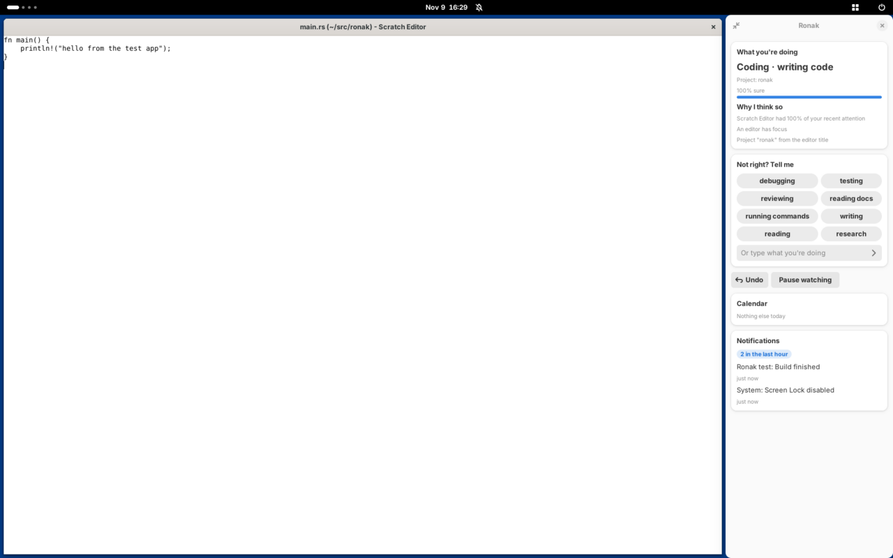

# Ronak · روناک

*Kurdish for light, clarity.*

Ronak is a **local-first, intent-aware context layer for the desktop**. It
notices what you are working on (coding, writing, a meeting), down to the
activity and project (debugging `ronak`), and arranges your screen for it, so
you never have to drag a window corner again. It shows what it understood,
and why, in a small panel; when it is wrong, you tell it in one tap and it
learns from that.

Everything runs on your own machine. Nothing is sent anywhere.

> **Status: v0.2, early.** Everything below is tested end to end in a real
> GNOME Shell 46 running without a screen (`scripts/headless-test.sh`), with
> the extension, the daemon, the panel and a test app. It has not yet been
> used day to day on a real laptop. That is the next step.



## What it does today

- **Observes** windows, focus, workspaces, monitors and idle time through a
  small GNOME Shell extension, with privacy rules applied before data leaves
  the compositor.
- **Reads inside the focused app** through the accessibility bus (AT-SPI),
  like a screen reader: the focused field, the selected tab, the end of a
  terminal. Password fields are never read.
- **Infers your task** from focus history with a transparent heuristic,
  gives each window a role (primary, reference, monitor, background), then
  refines it into an **activity** (debugging, testing, reviewing, in a call)
  and a **project**, with the **evidence** for each guess.
- **Uses context** from media players, your calendar (a meeting that is
  happening now) and notifications, each allowed per kind: off, read or act.
- **Shows a panel** (**Super+Alt+Space**), docked on the right or floating:
  what Ronak thinks you are doing and why, one-tap corrections, the layout
  suggestion, and glances at media, calendar and notifications.
- **Learns from corrections**: "Not right? Tell me" switches immediately and
  saves your label as training data.
- **Suggests a layout** computed by a deterministic solver, shown in the top
  bar. **Super+Alt+Enter** applies it, **Super+Alt+Z** undoes, **Super+Alt+P**
  pauses. During meetings it also offers to silence notifications.
- **Remembers** in an encrypted local database (SQLCipher, key in GNOME
  Keyring), keeping raw events for 30 days.
- **Finds your AI hardware**: NPUs, GPUs, CPU features and local LLM servers,
  and plans where each model should run (`ronakd probe`).
- **Serves context to AI agents** over the Model Context Protocol, with
  titles hidden by default (`ronakd mcp`). Agents may **propose** a layout or
  a panel card; nothing happens until you accept.
- **Talks to your MCP servers** as a client (a GitHub or notes server), and
  gives apps outside your current task a lower CPU share.

## Try it in two minutes, with a simulated desktop

Needs Rust 1.89 or newer ([rustup.rs](https://rustup.rs); Ubuntu's packaged Rust is too old),
plus `sudo apt install build-essential pkg-config perl libgtk-4-dev libadwaita-1-dev`.

```bash
git clone https://github.com/abdullah-celik/Ronak.git ronak && cd ronak
export RONAK_DATA_DIR=/tmp/ronak-mock RONAK_RUNTIME_DIR=/tmp/ronak-mock/run RONAK_ENCRYPTION=none
cargo run -p ronakd -- run --platform mock --auto-accept --mock-beat-ms 500
```

In a second terminal (same three `export`s):

```bash
cargo run -q -p ronakd -- status
cargo run -q -p ronakd -- context --detail full
cargo run -q -p ronakd -- correct writing --project thesis   # "that's not what I'm doing"
cargo run -q -p ronakd -- probe
```

To see the panel without a desktop session:
`cargo run -p ronak-panel -- --demo schema/examples/panel/demo.json`.

## Run it on your GNOME desktop

```bash
sudo apt install libglib2.0-bin gnome-shell-extensions
scripts/install-dev.sh          # builds, installs ronakd and ronak-panel, links the extension, adds the service
scripts/nested-shell.sh         # try it in a nested GNOME session first: crashes can't hurt you
```

When you are happy with it:

```bash
gnome-extensions enable ronak@ronak.dev    # then log out and back in
systemctl --user enable --now ronakd
ronakd status
```

Logs: `journalctl --user -u ronakd -f` (daemon) and
`journalctl -f -o cat /usr/bin/gnome-shell | grep ronak` (extension).
Uninstall with `scripts/uninstall-dev.sh` (`--purge` also deletes data).

## Use it from an AI agent

Any MCP client can launch `ronakd mcp` as a stdio server. For example, in
Claude Code:

```bash
claude mcp add ronak -- ~/.local/bin/ronakd mcp
```

Tools: `get_current_task`, `get_current_context`, `get_layout_suggestion`,
`get_hardware_profile`, and the proposal tools `propose_layout` and
`propose_surface` (cards built from the [surface catalog](schema/surface.schema.json)).
What an agent may see is set in `~/.config/ronak/config.toml` under `[mcp]`.

## Documentation

- [OS primer](docs/OS-PRIMER.md): Wayland, compositors, extensions, D-Bus,
  systemd, sockets, keyrings and NPUs, explained with commands to try.
- [Architecture](docs/ARCHITECTURE.md): layers, crates, data flow, and how to
  add Windows or another desktop.
- [Privacy and trust](docs/PRIVACY.md): what is recorded, guarantees, limits.
- [Vision](docs/VISION.md): where this is going, from arranging windows to an
  intent-native desktop.
- [Design decisions](docs/DECISIONS.md) and [Roadmap](docs/ROADMAP.md).
- [Context schema](schema/context.schema.json),
  [adapter protocol](schema/adapter-protocol.schema.json) and
  [surface catalog](schema/surface.schema.json), with
  [examples](schema/examples/).
- [Example configuration](config/ronak.example.toml).

## Repository layout

```text
schema/                 open JSON Schemas (source of truth) + examples
crates/ronak-core       platform-independent model, privacy, intent, activity, surfaces, layout, actions
crates/ronak-hw         NPU/GPU/CPU detection and inference planning
crates/ronak-store      encrypted SQLite store (events, content for 24 h, digests, labels)
crates/ronak-gnome      daemon side of the GNOME adapter (D-Bus)
crates/ronak-atspi      reading inside apps over the accessibility bus
crates/ronak-caps       media (MPRIS), calendar (EDS), MCP client, CPU weight
crates/ronak-panel      the panel app (GTK 4 + libadwaita)
crates/ronakd           the daemon and CLI (control socket, sensors, MCP, LLM tier, mock desktop)
extension/              GNOME Shell extension (GJS) and its tests
scripts/                install, nested session, headless end-to-end test, uninstall
packaging/              systemd user service, panel desktop entry
docs/                   primer, architecture, privacy, decisions, roadmap
```

## Development

```bash
cargo test --workspace            # Rust: unit, schema-validation and daemon tests
(cd extension && npm test)        # JS: privacy rules (same fixture as Rust), notifications, panel geometry
cargo clippy --workspace --all-targets -- -D warnings
scripts/headless-test.sh          # real GNOME Shell without a screen; needs gnome-shell, python3-gi, jq
```

## License

The daemon, crates and schemas are dual-licensed under
[MIT](LICENSE-MIT) or [Apache-2.0](LICENSE-APACHE), at your option. The
GNOME Shell extension in `extension/ronak@ronak.dev` is licensed
[GPL-2.0-or-later](extension/ronak@ronak.dev/LICENSE), as GNOME requires for
extensions.
